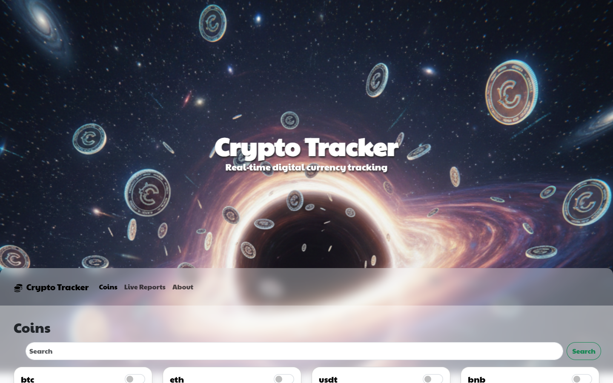
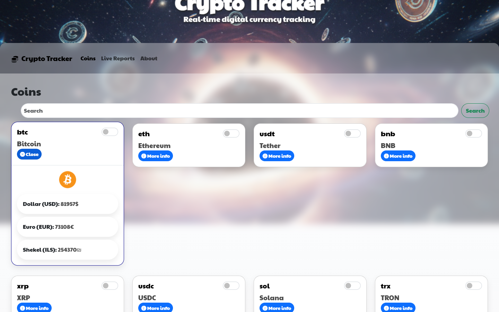
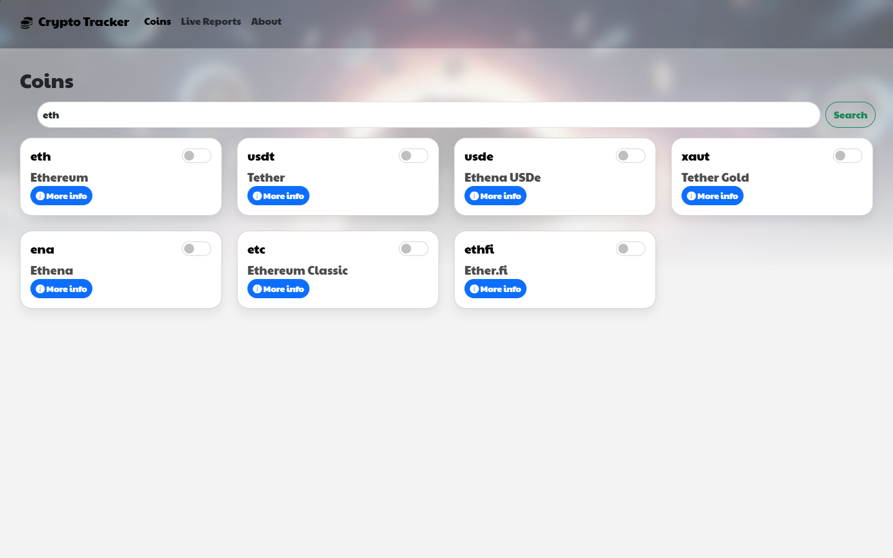
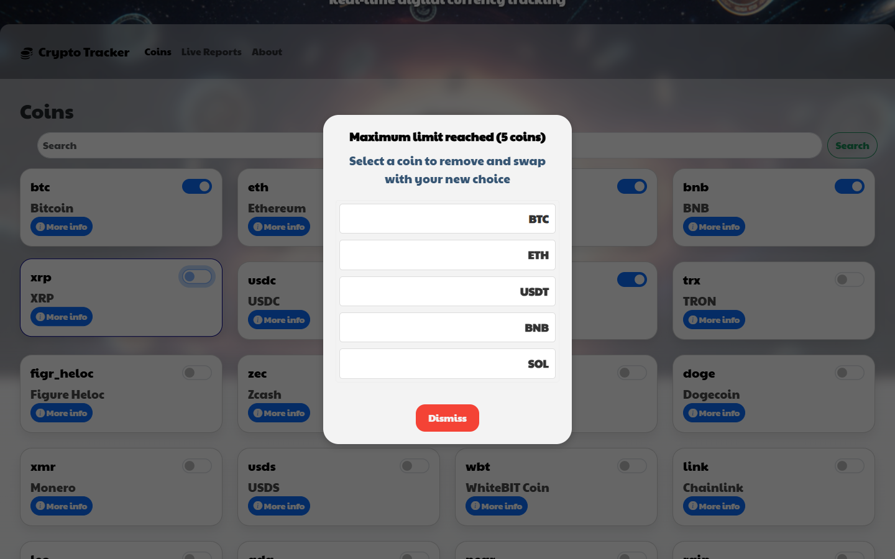
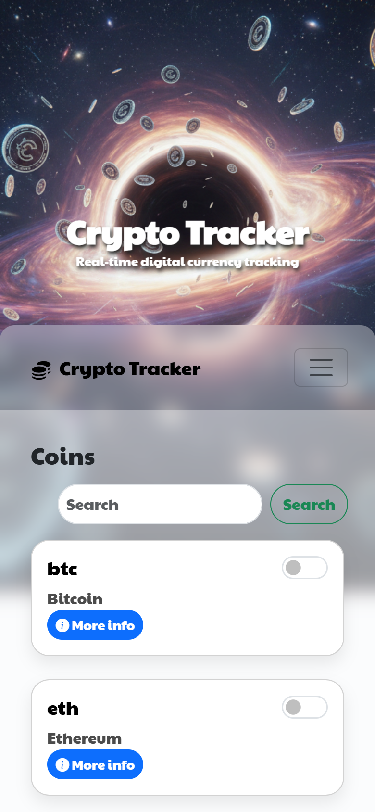

<div align="center">

# 🪙 Crypto Tracker

**Real-time cryptocurrency tracking in the browser: browse the top 100 coins, check live prices in USD / EUR / ILS, and build a personal watchlist.**

[](https://dotcomico.github.io/crypto/)




</div>

---

## 📖 About the Project

**Crypto Tracker** is a single-page web app that pulls live market data from the public [CoinGecko API](https://www.coingecko.com/en/api) and shows it in a clean, responsive card layout.

Users can:

- Browse the **top 100 cryptocurrencies** ranked by market cap
- **Search** by coin name or symbol
- Open **More info** on any coin to see its logo and live price in **US Dollars, Euros, and Israeli Shekels**
- Toggle up to **5 coins** into a personal report list that is saved between visits

It's built with **vanilla JavaScript (ES modules), jQuery, and Bootstrap 5**. There is no framework and no build step. The focus was on clean, modular code: a separate API layer, data/state modules, and UI renderers. It also caches data on the client so the app doesn't call the API more often than it needs to.

> 🔗 **Try it live:** **https://dotcomico.github.io/crypto/**

---

## 📸 Screenshots

| Live coin details (USD / EUR / ILS) | Search by name or symbol |
| :---: | :---: |
|  |  |

| 5-coin limit: pick one to swap | Fully responsive (mobile) |
| :---: | :---: |
|  |  |

---

## ✨ Features

| Feature | Details |
| --- | --- |
| 📈 **Live market data** | Fetches the top 100 coins by market cap from CoinGecko on load |
| 🔍 **Instant search** | Case-insensitive filtering by name **or** symbol; clearing the field restores the full list |
| 💱 **Multi-currency prices** | "More info" shows the coin's live price in **USD, EUR and ILS** with a smooth slide-down animation |
| ⚡ **Smart caching** | Coin details are cached in `localStorage` for **2 minutes**. Re-opening a coin within that window loads instantly with no extra API call |
| ⭐ **Report watchlist** | Toggle switches add coins to a report list (max **5**) that persists across sessions |
| 🔄 **Swap dialog** | Selecting a 6th coin opens a custom modal so you can choose which coin to replace |
| 🛡️ **Graceful error handling** | Clear alert if the API is unreachable; per-card error state with automatic recovery after 3 seconds (e.g. on API rate limits) |
| 🌌 **Parallax header** | Pure-CSS parallax effect (`perspective` + 3D transforms), no JavaScript scroll listeners |
| 📱 **Responsive design** | Bootstrap grid: 4 columns on desktop, 1 column on mobile, with a collapsible navbar |
| 🧭 **SPA navigation** | Coins / Live Reports / About views switch without a page reload |

---

## 🛠️ Tech Stack

| Layer | Technology |
| --- | --- |
| **Language** | JavaScript (ES6+, native ES modules) |
| **DOM & Events** | jQuery 3.7 |
| **UI / Layout** | Bootstrap 5.3, Bootstrap Icons |
| **Markup & Styling** | HTML5, CSS3 (modular per-section stylesheets, CSS parallax) |
| **Data Source** | [CoinGecko REST API](https://www.coingecko.com/en/api) (`/coins/markets`, `/coins/{id}`) |
| **Persistence** | Browser `localStorage` (price cache + watchlist) |
| **Hosting** | GitHub Pages |

---

## 🏗️ Architecture

The code is split into three layers. Each file has a single responsibility, so the API layer knows nothing about the DOM and the UI layer never calls `fetch` directly.

```
crypto/
├── index.html                    # Single page: header, navbar, 3 views, dialog
├── css/
│   ├── base.css, header.css      # Global styles + parallax header
│   ├── dialog.css, responsive.css
│   └── sections/                 # One stylesheet per view (coins, reports, about)
├── js/
│   ├── Main.js                   # App controller: bootstraps data, wires search & dialog events
│   ├── api/
│   │   └── CoinApiService.js     # All HTTP calls to CoinGecko live here
│   ├── modules/                  # Data & state (no rendering)
│   │   ├── CoinData.js           # Model class with built-in cache expiry (isUpToDate)
│   │   ├── CoinsDataManager.js   # localStorage cache for coin price details
│   │   ├── ReportCoinsManager.js # Watchlist state + 5-coin limit
│   │   ├── CoinSearchHandler.js  # Pure filter function
│   │   └── CoinSwitchHandler.js  # Toggle switch ↔ watchlist sync
│   └── ui/                       # Rendering & DOM only
│       ├── CoinCardRenderer.js   # Builds the coin cards grid
│       ├── CoinInfoDisplay.js    # "More info" panel: cache-or-fetch, loading & error states
│       ├── MaxCoinsDialogManager.js
│       ├── ErrorAlert.js
│       └── Navigation.js         # SPA view switching
└── Image/                        # Header art, icons, loader
```

### How "More info" works

```
Click "More info"
      │
      ▼
Is this coin in the localStorage cache AND younger than 2 minutes?
      │                                   │
     YES                                  NO
      │                                   │
      ▼                                   ▼
Render instantly from cache     Show loader → fetch /coins/{id} → save to cache → render
                                          │
                                       on error → red "Error" button, auto-reset after 3s
```

**Why it's built this way:** CoinGecko's free tier has strict rate limits. Caching each coin's details for a short window keeps prices reasonably fresh, avoids unnecessary calls, and makes repeat clicks instant.

---

## 🚀 Getting Started

No installation or build step is needed. All libraries load from CDNs.

```bash
git clone https://github.com/dotcomico/crypto.git
cd crypto
```

Because the app uses **native ES modules**, it must be served over HTTP (opening `index.html` directly via `file://` won't work). Use any static server, for example:

```bash
# Option 1: VS Code "Live Server" extension (right-click index.html → Open with Live Server)

# Option 2: Node
npx serve .

# Option 3: Python
python -m http.server 8000
```

Then open `http://localhost:8000` (or the port your server prints).

---

## 🗺️ Roadmap

- [ ] **Live Reports:** real-time price chart for the (up to 5) coins selected in the watchlist (UI placeholder already in place)
- [ ] Show market cap and 24h change on each card
- [ ] Debounced live search while typing

---

## 👤 Author

**Dotan Siman Tov**, Full-Stack Developer

[](https://github.com/dotcomico)
[](mailto:Dotanst100@gmail.com)

---

<div align="center">
<sub>Market data provided by <a href="https://www.coingecko.com/">CoinGecko</a>.</sub>
</div>
